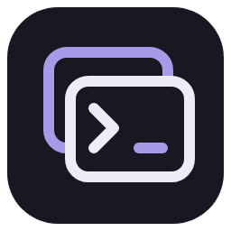
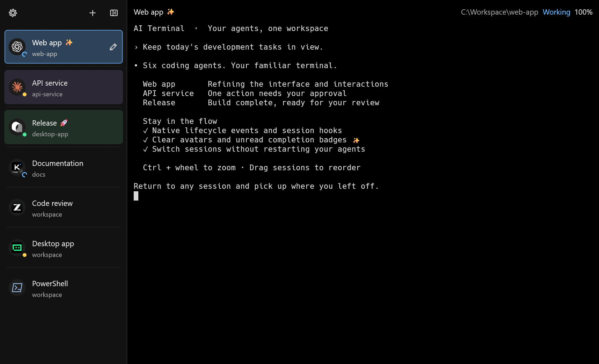
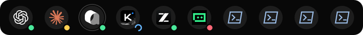

<div align="center">



# AI Terminal

**A calmer workspace for your AI sessions.**

Use Codex, Claude Code, Qoder CN, Kimi Code, ZCode and TRAE CLI in a familiar terminal, keep an eye on their status, and return to any session in a click.

[](https://github.com/FengLP5263/ai-terminal/releases/latest)
[](#platform-support)
[](LICENSE)

[Get started](#quick-start) · [Features](#built-for-multiple-sessions) · [Supported Agents](#supported-agents) · [Changelog](CHANGELOG.en.md) · [FAQ](#frequently-asked-questions) · [Contribute](CONTRIBUTING.en.md)

[简体中文](README.md) | English

</div>

## Why AI Terminal?

AI tasks can run for a long time. When several windows are open, repeatedly checking which session is working or needs attention can interrupt your focus. AI Terminal brings terminal sessions and their status together so you can keep using your familiar Shell and Agent, and return when needed.

It is a native Windows terminal workspace. It does not bundle a model service or require you to change your CLI login, permissions, or workflow.

## A look inside



Enable the floating bar to see session avatars and status above other windows. Click an avatar to return to that session:



> Screenshots use the real 0.4.8 interface with synthetic sessions, example directories and simulated status. They contain no real usernames, working directories or private conversations. Click an image for its original resolution.

## Built for multiple sessions

| Feature | What you can do |
| --- | --- |
| **A real terminal** | Open PowerShell, CMD, or Git Bash and run your installed command-line tools directly. |
| **Agent recognition** | Starting Codex, Claude Code, Qoder CN, Kimi Code, ZCode or TRAE CLI displays the corresponding avatar; other commands still work as ordinary terminal sessions. |
| **Task status** | See working, needs attention, completed, or failed states for supported Agents in the sidebar and floating bar. Status comes from supported lifecycle notifications and process exits; it is not a universal inference for every CLI. |
| **Always-on-top bar** | Show only session avatars and status, up to 10 at a time. Drag the avatar area to see more, and click an avatar to return to its session. |
| **Your workspace** | Drag to reorder, rename or color sessions, collapse the sidebar, and scale the entire interface with Ctrl + mouse wheel. |
| **Familiar terminal behavior** | Use Chinese text, ANSI colors, and system color emoji; pass clipboard images to Codex, Claude Code or Qoder CN CLI for the CLI to handle. |
| **Chinese and English** | Follow the system language or choose Simplified Chinese or English in settings. |

## Supported Agents

| Icon | Agent | Windows command | Avatar and launch/exit recognition | Automatic task status |
| --- | --- | --- | --- | --- |
|  | [Codex CLI](https://github.com/openai/codex) | `codex` | Supported | Native lifecycle; compatibility hooks for older versions |
|  | [Claude Code](https://docs.anthropic.com/en/docs/claude-code/overview) | `claude` | Supported | Session-scoped hooks |
|  | [Qoder CN CLI](https://docs.qoder.cn/en/cli/installation) | `qodercn` / `qoderclicn` | Supported | Session-scoped hooks |
|  | [Kimi Code CLI](https://www.kimi.com/code/docs/) | `kimi` | Supported | Native lifecycle (Kimi Code 2.5.0) |
|  | [ZCode](https://zcode.z.ai/) | `zcode` | Supported | Session hooks: start / tools / completion; configuration limits below |
|  | [TRAE CLI](https://docs.trae.cn/cli_about-trae-code-cli-2) | `traecli` | Supported | Session-scoped hooks; review trust in the CLI |

Status comes only from explicit lifecycle events, hooks and process exits. Without an event, the manager keeps “Awaiting task events” and never infers completion from terminal text or silence. The new integrations are available from 0.4.8. Startup checks, synthetic events and real model turns are recorded separately; 0.4.7 still recognizes only identity and launch/exit for these three CLIs.

- Kimi: the managed `kimi` entry enables OSC 7501 for this process, covering work, permission/question/login waits, completion and failure. Child-agent records and message bodies are discarded. Explicit `PI_PROGRAM_STATUS=0` keeps it disabled.
- TRAE: the current enterprise CLI requires a TRAE Enterprise flagship account and its PAT; a personal subscription or third-party model API key is not a substitute. See the [official CLI guide](https://docs.trae.cn/cli_about-trae-code-cli-2). Invocation-scoped `-c` options provide lifecycle hooks without editing user/project files. Review trust in `/hooks`. Later explicit overrides remain CLI-owned; local hooks are not guaranteed with remote servers.
- ZCode: applies only to community zcode-app-cli 3.17.2-44 / runtime 0.17.1. Start, tools, question tools and completion are supported. Status follows received hooks directly: start/tool execution shows Working, question interactions show Needs attention, and Stop shows Completed. The interface lacks some approval-wait, task-failure and interruption events. Without a later event, the last state remains; explicit failure or abnormal exit is required for Failed. `ZCODE_CLI_SETTINGS_FILE` selects a basic settings snapshot for this process. Only credential-free basic options are allowed; existing hooks, nonempty custom lists, MCP/plugin definitions, unknown settings or an explicit environment override preserve the original configuration and skip integration. Provider/credential files are never opened. Settings changed in the snapshot last only for this invocation; status connection help explains the custom-configuration boundary.

Restart existing CLI processes to apply these integrations. Review login, workspace trust and hook trust within each Agent.

ZCode was tested with the community distribution [zcode-app-cli](https://github.com/kingsword09/zcode-cli) 3.17.2-44 (runtime 0.17.1), not as acceptance of Z.ai's official standalone CLI. The manager forwards the installed public `zcode` entry and neither bundles nor installs Agents automatically. Icons reuse the production painter on a dark surface for legibility on light and dark README pages; see [third-party notices](THIRD_PARTY_NOTICES.en.md).

## Platform support

| Platform | Status |
| --- | --- |
| Windows x64 | Supported |
| macOS / Linux | Native GUI not currently supported |

## Quick start

### 1. Download and run

Download the Windows x64 ZIP from [GitHub Releases](https://github.com/FengLP5263/ai-terminal/releases/latest), **extract the entire archive**, and run `ai-terminal.exe`. Starting with 0.4.3, keep `ai-terminal.exe`, `ai-terminal-hook.exe`, `conpty.dll`, and `OpenConsole.exe` together. Rust, Python, and Electron are not required to run the release package.

### 2. Open a terminal and start an Agent

Select a Shell with the **+** button at the top left, or press <kbd>Ctrl</kbd> + <kbd>Shift</kbd> + <kbd>N</kbd> for a new PowerShell session. Change to your project directory and run an installed CLI (replace the example path with your own):

```powershell
cd 'C:\path\to\your-project'
codex
# or run claude / qodercn / kimi / zcode / traecli
```

Install and configure [Codex CLI](https://github.com/openai/codex), [Claude Code](https://docs.anthropic.com/en/docs/claude-code/overview), [Qoder CN CLI](https://docs.qoder.cn/en/cli/installation), Kimi Code, ZCode or TRAE CLI separately. AI Terminal respects the CLI's own login, model, trust, and permission settings.

### 3. Make it yours

Use the gear at the top left to set the language and floating bar. Hover over a session avatar for details and click it to switch sessions. Drag the floating bar to reposition it, and turn it off in settings. Hold <kbd>Ctrl</kbd> and scroll to scale the entire interface.

Interactively launching `powershell`, `cmd` or `bash` through a managed entry updates the avatar to the current shell; `exit` restores each level. Codex/Claude/Qoder CN/Kimi Code/ZCode/TRAE CLI take avatar priority while active, then return to the current shell. One-off scripts and tool commands inside Agents do not change shell identity.

## Frequently asked questions

### Why is an installed CLI not found?

Make sure its Windows `.exe`, `.cmd`, or `.bat` launcher is available on the current, user, or system `PATH`. A program installed only in WSL or exposed only as a PowerShell alias is not a supported Windows entry point.

### Can I use it without Git Bash?

Yes, use PowerShell or CMD directly. Git Bash is optional; selecting it when unavailable offers a button to switch to an available shell. Portable Git needs its `cmd` or `bin` directory on `PATH`. Git Bash loads its system/user startup configuration, preserving prompts, aliases and completion.

### Why is there no Agent status?

Status depends on explicit CLI lifecycle notifications. Codex uses native events while preserving the shared agents overview; older versions can explicitly run `codex --no-daemon` for compatibility hooks. Claude Code and Qoder CN use session-scoped hooks. Stable 0.4.7 only recognizes Kimi Code, ZCode and TRAE CLI avatars and launch/exit. The table above describes integration in 0.4.8. Without notifications, status stays "Awaiting task events"; a ZCode start event shows "Working", followed by subsequent hook updates. The manager never trusts hooks or edits user/project hook configuration on your behalf.

### Can I continue a conversation after restarting?

The app restores the session list and interface settings, not running processes or terminal screen contents. Continue conversations with the CLI's own recovery feature. Exit reaps only owned terminals/helpers; tasks in Codex's shared server may keep running under Codex's control.

### How do I scroll terminal history or paste an image?

Use the mouse wheel for history. When a full-screen app takes over the wheel, use <kbd>Shift</kbd> + wheel for local history. When Codex, Claude Code, Qoder CN, Kimi Code, ZCode or TRAE CLI is recognized, <kbd>Ctrl</kbd> + <kbd>V</kbd> or <kbd>Shift</kbd> + <kbd>Insert</kbd> passes a clipboard image to the CLI.

### Does the first run create a desktop shortcut?

When launched for the first time with the default data directory, the app tries to create `ai-terminal.lnk` on the Desktop so it is easy to reopen. It attempts once and startup continues if creation fails. Runs using `--data-dir` with a non-default data directory, isolated smoke runs, or a failed workspace load never create it, and a shortcut deleted by the user is not recreated. The shortcut targets the current `ai-terminal.exe` with no arguments or credentials.

### Are conversations or API keys saved?

The default data directory is `%LOCALAPPDATA%/ai-terminal`. It stores session metadata, interface preferences, and temporary hook configuration, not prompts, conversation text, or API keys. Each CLI manages its own data and configuration.

## Develop from source

You will need Windows x64, Rust stable MSVC, Visual Studio C++ Build Tools, the Windows SDK with `rc.exe`, and Python 3.11+.

```powershell
git clone https://github.com/FengLP5263/ai-terminal.git
cd ai-terminal
rustup component add rustfmt clippy
.\scripts\windows\project.ps1 ci
.\scripts\windows\project.ps1 run
```

`ci` runs governance, formatting, Clippy, Rust, and Python checks without calling model APIs. Artifact source identity covers the local graphics patch, its shaders, and the window-backend patch. See the [documentation](docs/README.en.md) and [development scripts](scripts/README.en.md) for development, testing, and packaging details.

## Contribute

Issues, ideas, terminal improvements, and documentation contributions are welcome! Please read the [contributing guide](CONTRIBUTING.en.md) and [collaboration guidelines](AGENTS.en.md) first. Do not include credentials or private conversations in reports.

[Open an issue](https://github.com/FengLP5263/ai-terminal/issues) · [Contributing guide](CONTRIBUTING.en.md) · [Documentation](docs/README.en.md)

## License

Project code is available under the [MIT License](LICENSE). Third-party components retain their own licenses; see [third-party notices](THIRD_PARTY_NOTICES.en.md).

Agent brand-icon provenance and licenses are recorded per file; see [third-party notices](THIRD_PARTY_NOTICES.en.md). ZIPs include provenance and available original license texts in agent-icons/.

## 0.4.8 update

Add Kimi Code native lifecycle and ZCode/TRAE CLI session-scoped task hooks. Fix clipped floating hints and follow ZCode hook states directly. Refresh Chinese and English workspace/floating screenshots. The table above lists support boundaries and icons for all six Agents. See the [bilingual changelog](CHANGELOG.en.md) for changes, upgrade notes and verification scope. Each release ZIP includes both files.
