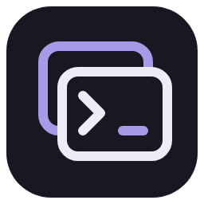
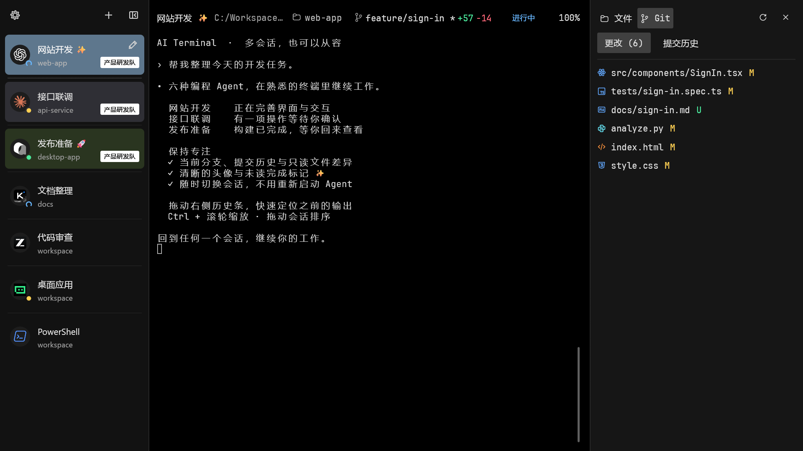
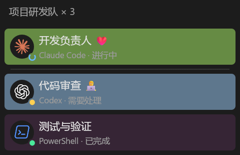
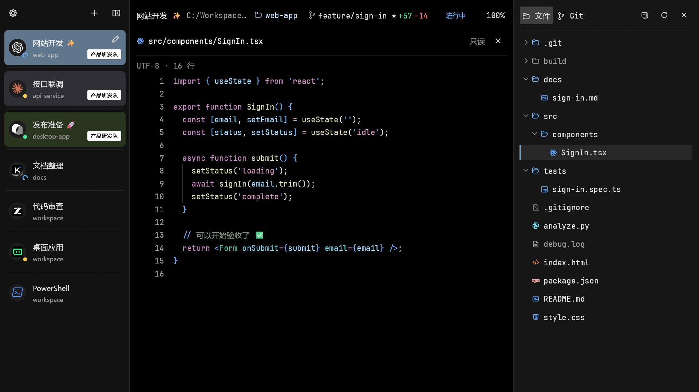
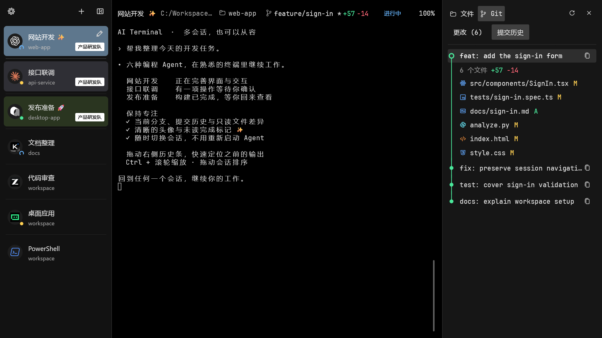
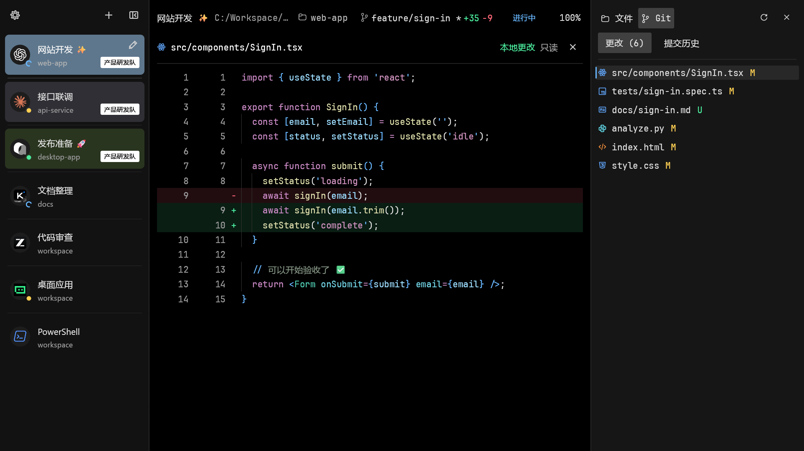
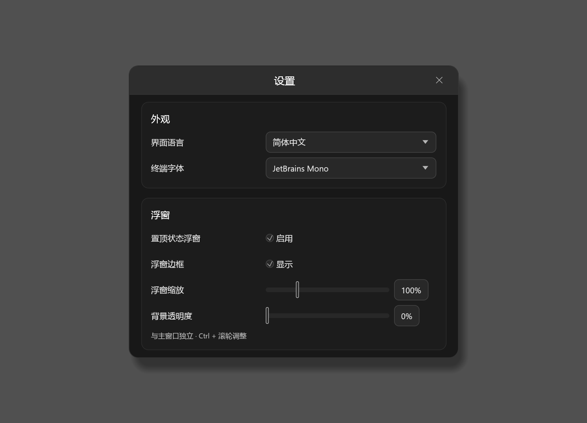

<div align="center">



# AI Terminal

**给多个 AI 会话，一个清爽的工作空间。**

在熟悉的终端里使用 Codex、Claude Code、Qoder CN、Kimi Code、ZCode 和 TRAE CLI，随时查看会话状态，需要时一键返回。

[](https://github.com/FengLP5263/ai-terminal/releases/latest)
[](#平台支持)
[](LICENSE)

[下载使用](#快速开始) · [功能介绍](#为多会话而设计) · [Git 工作区](#查看-git-更改与历史) · [支持的 Agent](#支持的-agent) · [更新日志](CHANGELOG.md) · [常见问题](#常见问题) · [参与贡献](CONTRIBUTING.md)

简体中文 | [English](README.en.md)

</div>

## 为什么做 AI Terminal？

AI 任务可能运行很久。打开多个窗口后，来回确认哪个会话还在工作、哪个需要处理，很容易打断手头的事。AI Terminal 把终端会话和状态集中起来，让你继续使用自己熟悉的 Shell 和 Agent，需要时再回到对应会话。

它是一个 Windows 原生终端工作区，不内置模型服务，也不要求你改变现有 CLI 的登录、权限或工作习惯。

## 看看界面



开启浮窗后，可以在其他工作窗口上方查看会话头像和状态，点击头像回到对应会话：


> 截图使用 0.11.0 的真实原生组件；会话、终端文本、Git 元数据及任务状态均为展示样例，不包含真实用户数据或私人对话。点击图片可查看原始分辨率。

## 为多会话而设计

| 功能 | 你可以做什么 |
| --- | --- |
| **真正的终端** | 新建 PowerShell、CMD 或 Git Bash，在里面直接运行已安装的命令行工具。 |
| **会话分组** | 右键会话新建或加入队伍，用紧凑的白底黑字工牌识别同组会话；浮窗显示组内第一个头像及简化工牌，悬停按“组名 × N”查看带原有配色的成员并点击切换。 |
| **Agent 会话识别** | 启动 Codex、Claude Code、Qoder CN、Kimi Code、ZCode 或 TRAE CLI 后显示对应头像；其他命令仍可作为普通终端使用。 |
| **任务状态** | 在侧栏和浮窗中查看支持的 Agent 的进行中、需要处理、完成或失败状态。状态来自支持的生命周期通知和进程退出，并非对所有 CLI 的通用推断。 |
| **置顶浮窗** | 只显示会话头像和状态，一次最多显示 10 个；拖动头像区域可查看其余会话，点击头像回到会话；缩放独立于主窗口，可在设置或浮窗上的 Ctrl + 滚轮调整；背景透明度可在设置中即时调节，头像和状态标记保持清晰。 |
| **整理自己的工作区** | 拖动会话排序、重命名、设置颜色、收起侧栏；使用 Ctrl + 滚轮调整整个界面大小。 |
| **熟悉的终端体验** | 支持中文、ANSI 颜色和系统彩色 emoji；Codex／Claude Code／Qoder CN CLI 可使用剪贴板图片，具体交互由对应 CLI 处理。 |
| **项目文件** | 在右侧浏览项目文件树，点击文件只读查看语法高亮、行号与 emoji；与 Git 共用切换页和标准图标。见[项目文件](docs/files.md)。 |
| **Git 工作区** | 顶部查看当前分支及增删行数；右侧可收起面板查看文件更改和当前分支的提交历史，随终端目录更新。详见 [Git 面板](docs/git.md)。 |
| **快速定位长输出** | 拖动终端右侧历史滚动条或点击轨道，回看之前的内容；最多保留 5000 行历史。 |
| **只读文件差异** | 点击本地更改或提交文件，查看完整正文、语法高亮及红绿增删背景。 |
| **终端字体** | 默认 JetBrains Mono，设置修改立即生效并自动保存；可切换 Cascadia Mono、Hack 及两款可用的 Windows 字体；运行会话保持连接，已保存的选择不变。 |
| **中英双语** | 自动跟随系统语言，也可在设置中手动选择简体中文或 English。 |

## 将会话组成队伍

右键会话 →“分组”，新建队伍或加入已有分组。成员卡片会显示相同的白底黑字工牌；仍可单独重命名、改色与拖动排序，也可移出、重命名或解散分组。解散会保留所有会话。

浮窗只显示每组排序第一的头像，角标与收起侧栏使用同款极简工牌。悬停后查看“组名 × N”和所有成员的头像、标题及状态，点击进入对应终端。首位下方有中性细分隔线，其余卡片保留配色和间距；排序仅帮助你组织队伍，不赋予额外权限或合并会话历史。



组内需要处理或未读的状态仍会在浮窗提示。分组、移出与解散不会重启终端；关闭或移出首位后，浮窗按现有顺序使用下一位头像。

## 浏览项目文件

点击终端顶部的文件夹图标，在右侧“文件”页浏览当前项目的目录结构；可与“Git”切换，拖动调整面板宽度。文件夹按需展开，支持刷新和全部收起，普通目录也能使用。Git 忽略项以灰色名称和图标区分，仍可展开、查看，悬停显示说明。

点击文件，在中间区域只读查看完整正文、行号、语法高亮、缩进线和彩色 emoji，右侧持续标记当前文件。关闭文件后返回原终端，Agent 和后台输出保持运行。读取边界与编码支持见[项目文件说明](docs/files.md)。



## 查看 Git 更改与历史

在 Git 仓库中工作时，终端顶部会与会话名称、路径一起显示当前分支及增删行数。点击分支名打开右侧 Git 面板，可在“更改”和“提交历史”之间切换；面板支持调宽和收起，终端会话继续运行。

“更改”展示文件状态和相对 HEAD 的净增删，合并已暂存、未暂存及未跟踪文本；“提交历史”展示当前分支可达的提交、作者、日期和提交 ID，每次加载 50 条，最多 300 条。历史以圆点连线展示，悬停查看提交详情并复制完整 ID，点击展开该次提交的更改文件。切换终端目录或修改仓库后自动刷新，也可点击“刷新”。



需要已安装 Git for Windows。面板提供只读查看，暂存、提交、拉取和推送仍在终端执行。二进制、内容过滤文件和大文件的统计边界见 [Git 面板说明](docs/git.md)。

终端右侧的历史滚动条支持拖动滑块和点击轨道，快速定位之前的输出；保留 5000 行历史，滚动操作不会向 CLI 发送方向键。

点击“更改”中的文件，查看当前文件相对 HEAD 的净变化，包含已暂存与未暂存修改；未跟踪文件显示整份新增，并以绿色 U 标记，悬停说明“未跟踪”。点击展开提交下的文件，可查看该次提交的差异。两者都从首行展示到末行，带旧／新行号、按文件类型的语法高亮（含 PowerShell、Shell、TS/TSX、JSON、Markdown 等）、缩进参考线、彩色 emoji 及当前文件指示；红绿背景标记增删，代码文字保留语法颜色，关闭后回到原终端。



文件视图只读，不提供编辑。编码、二进制、大小与链接等读取边界见 [Git 面板](docs/git.md)。

## 设置与浮窗

设置修改立即生效并自动保存。浮窗默认显示细边框，可单独关闭；浮窗缩放与主窗口独立，背景透明度可在 0%–100% 间调整，头像和状态标记保持清晰。设置、重命名及确认弹窗使用与桌面界面协调的紧凑文字和控件。



## 支持的 Agent

| 图标 | Agent | Windows 启动命令 | 头像与启动／退出识别 | 自动任务状态 |
| --- | --- | --- | --- | --- |
|  | [Codex CLI](https://github.com/openai/codex) | `codex` | 支持 | 原生生命周期；旧版兼容 hook |
|  | [Claude Code](https://docs.anthropic.com/en/docs/claude-code/overview) | `claude` | 支持 | 会话级 hook |
|  | [Qoder CN CLI](https://docs.qoder.cn/en/cli/installation) | `qodercn` / `qoderclicn` | 支持 | 会话级 hook |
|  | [Kimi Code CLI](https://www.kimi.com/code/docs/) | `kimi` | 支持 | 原生生命周期（Kimi Code 2.5.0） |
|  | [ZCode](https://zcode.z.ai/) | `zcode` | 支持 | 会话级 hook：开始／工具／完成；有配置边界，见下文 |
|  | [TRAE CLI](https://docs.trae.cn/cli_about-trae-code-cli-2) | `traecli` | 支持 | 会话级 hook；需在 CLI 内审查信任 |

状态只来自明确生命周期、hook 与进程退出；未收到事件时保持“等待任务通知”，不根据终端文字或静默猜测完成。新增集成从 0.4.8 提供，启动核查、合成事件与真实模型回合分开记录；0.4.7 的三款新增 CLI 仍仅识别头像与启停。

- Kimi：受管 `kimi` 入口为本次进程启用原生 OSC 7501，区分工作、授权／问题／登录等待、完成与失败；忽略子 Agent 记录和消息正文。显式 `PI_PROGRAM_STATUS=0` 保持关闭。
- TRAE：当前企业版 CLI 需要 TRAE 企业旗舰版账号及其 PAT，个人订阅或第三方模型 API Key 不能替代。参见[官方 CLI 说明](https://docs.trae.cn/cli_about-trae-code-cli-2)。本次 `-c` 参数提供生命周期 hook，不改用户／项目配置；启动后在 `/hooks` 中审查信任。显式后续配置仍由 CLI 解释，远端服务不承诺本机 hook 可用。
- ZCode：仅针对社区 zcode-app-cli 3.17.2-44／运行时 0.17.1。支持开始、工具、问题工具与完成；状态直接跟随已收到的 hook：开始／工具执行显示进行中，问题交互显示需要处理，Stop 显示完成。当前接口缺少部分授权等待、任务失败及中断事件；没有后续通知时保留上次状态，明确失败或非正常退出才显示失败。通过 `ZCODE_CLI_SETTINGS_FILE` 选择本次进程的基础设置快照，仅允许无凭据的基础选项；已有 hook、非空自定义列表、MCP／插件定义、未知设置或显式该环境变量时保留原配置并跳过接入。不会打开 provider／凭据文件。快照内的设置修改仅对本次调用有效；原配置有自定义内容时，状态连接说明会提示该边界。

已有 CLI 需退出后重新启动，才能应用本次会话集成。登录、目录与 hook 信任由你在 Agent 内确认。

ZCode 本次实测的是社区发行 [zcode-app-cli](https://github.com/kingsword09/zcode-cli) 3.17.2-44（运行时 0.17.1），不作为 Z.ai 官方独立 CLI 验收。管理器转发已安装的公开 `zcode` 入口，不捆绑或自动安装任何 Agent。图标复用正式界面组件，以深色底衬保证在 README 的浅色／深色页面中均可辨识；品牌来源见[第三方说明](THIRD_PARTY_NOTICES.md)。

## 平台支持

| 平台 | 状态 |
| --- | --- |
| Windows x64 | 支持 |
| macOS / Linux | 暂不支持原生 GUI |

## 快速开始

### 1. 下载并启动

从 [GitHub Releases](https://github.com/FengLP5263/ai-terminal/releases/latest) 下载 Windows x64 ZIP，**完整解压**后运行 `ai-terminal.exe`。0.4.3 起请将 `ai-terminal.exe`、`ai-terminal-hook.exe`、`conpty.dll` 和 `OpenConsole.exe` 保留在同一目录。运行发行包不需要安装 Rust、Python 或 Electron。

### 2. 创建终端，启动 Agent

点击左上角 **＋** 选择 Shell，或按 <kbd>Ctrl</kbd> + <kbd>Shift</kbd> + <kbd>N</kbd> 新建 PowerShell。在终端中进入项目目录，输入已安装的 CLI 命令（将示例路径替换为自己的路径）：

```powershell
cd 'C:\path\to\your-project'
codex
# 或运行 claude / qodercn / kimi / zcode / traecli
```

请事先自行安装并配置 [Codex CLI](https://github.com/openai/codex)、[Claude Code](https://docs.anthropic.com/en/docs/claude-code/overview)、[Qoder CN CLI](https://docs.qoder.cn/cli/installation)、Kimi Code、ZCode 或 TRAE CLI。AI Terminal 沿用 CLI 自己的登录、模型、信任和权限设置。

### 3. 按自己的方式管理

在左上角齿轮中设置语言、终端字体和浮窗；悬停会话头像可查看信息，点击即可切换。浮窗可拖动位置，并可在设置中关闭。按住 <kbd>Ctrl</kbd> 滚动鼠标滚轮可缩放整个界面。

在受管终端里交互式启动 `powershell`、`cmd` 或 `bash` 时，头像会跟随当前 Shell；`exit` 逐层恢复。启动 Codex／Claude／Qoder CN／Kimi Code／ZCode／TRAE CLI 时优先显示 Agent 头像，退出后恢复当前 Shell。单次脚本命令和 Agent 内部的工具命令不会因此改变 Shell 头像。

终端默认使用内嵌 **JetBrains Mono** 与系统**微软雅黑 UI**，已有字体选择保持不变；设置中还可选择 Cascadia Mono、Hack 及可用的 Windows 字体。保持原来的自然渲染方式，内置字体的常规、粗体、斜体和粗斜体随程序提供。来源和许可见[第三方说明](THIRD_PARTY_NOTICES.md)。

## 常见问题

### 已经安装 CLI，为什么提示找不到命令？

请确认 Windows 可从当前或用户／系统 `PATH` 找到对应的 `.exe`、`.cmd` 或 `.bat` 启动器。仅安装在 WSL 中的程序或 PowerShell 别名不属于受支持的 Windows 入口。

### 没有安装 Git Bash 也能使用吗？

可以直接使用 PowerShell 或 CMD。Git Bash 是可选依赖；选择后若未找到安装，界面会提供切换到可用 Shell 的按钮。便携版 Git 需将 `cmd` 或 `bin` 目录加入 `PATH`。Git Bash 会加载其系统／用户启动配置，保留提示符、别名和补全。

### 为什么 Agent 没有显示状态？

状态依赖 CLI 明确的生命周期通知。Codex 默认使用原生状态并保留共享 agents 总览；旧版可显式运行 `codex --no-daemon` 使用兼容 hook。Claude Code 和 Qoder CN 通过会话级 hook 接入。稳定版 0.4.7 的 Kimi Code、ZCode 与 TRAE CLI 仅识别头像和启停；0.4.8 的接入范围见上方表格。未接收到通知时显示“等待任务通知”，ZCode 收到开始事件后显示“进行中”，后续随 hook 更新。管理器不替你信任 hook，也不修改用户或项目的 hook 配置。

### 重启后可以继续之前的对话吗？

程序恢复的是会话列表和界面设置，不会恢复原先运行的进程或终端屏幕内容。要继续 AI 对话，请使用对应 CLI 自带的会话恢复功能。退出只回收本程序拥有的终端及 helper；Codex 共享后台中的任务可能继续运行，由 Codex 自身管理。

### 怎么查看终端历史和粘贴图片？

普通滚轮用于查看历史；全屏应用接管鼠标滚轮时可用 <kbd>Shift</kbd> + 滚轮查看本地历史。识别到 Codex／Claude Code／Qoder CN／Kimi Code／ZCode／TRAE CLI 时，可通过 <kbd>Ctrl</kbd> + <kbd>V</kbd> 或 <kbd>Shift</kbd> + <kbd>Insert</kbd> 将剪贴板图片交给 CLI 处理。

### 首次运行会在桌面创建快捷方式吗？

使用默认数据目录首次启动时，程序会尝试在桌面创建 `ai-terminal.lnk`，便于关闭后再次打开；只尝试一次，创建失败不影响启动。使用 `--data-dir` 指定非默认数据目录、隔离 smoke 或工作区读取失败时不会创建，手动删除后也不会自动重建。快捷方式只指向当前 `ai-terminal.exe`，不含命令参数或凭据。

### 会保存我的对话或 API Key 吗？

默认数据位于 `%LOCALAPPDATA%/ai-terminal`，保存会话元数据、界面偏好及临时 hook 配置；不保存提示词、对话正文或 API Key。各 CLI 自己的数据和配置由其各自管理。

## 从源码开发

需要 Windows x64、Rust stable MSVC、Visual Studio C++ Build Tools、包含 `rc.exe` 的 Windows SDK 和 Python 3.11+。

```powershell
git clone https://github.com/FengLP5263/ai-terminal.git
cd ai-terminal
rustup component add rustfmt clippy
.\scripts\windows\project.ps1 ci
.\scripts\windows\project.ps1 run
```

`ci` 包含治理、格式、Clippy、Rust 和 Python 检查，不调用模型 API。发行包的源码摘要覆盖本地图形补丁、着色器及窗口后端补丁。开发、测试和打包的详细说明见[文档目录](docs/README.md)及[开发脚本](scripts/README.md)。

## 一起完善

欢迎反馈问题、分享想法、改进终端体验和文档！提交之前，请先阅读[贡献指南](CONTRIBUTING.md)和[协作规范](AGENTS.md)。反馈问题时请勿包含凭据或私人对话。

[提交 Issue](https://github.com/FengLP5263/ai-terminal/issues) · [查看贡献指南](CONTRIBUTING.md) · [浏览文档](docs/README.md)

## 许可证

项目代码使用 [MIT License](LICENSE)。第三方组件保留各自的许可证，详见[第三方声明](THIRD_PARTY_NOTICES.md)。

Agent 品牌图标的来源与许可按文件分别记录，详见[第三方说明](THIRD_PARTY_NOTICES.md)；ZIP 的 agent-icons/ 附带来源清单和可获得的原始许可。

## 0.4.9 更新

修复 Qoder 自动审批的错误状态提示、TUI 光标查询与中文块光标、浮窗提示的彩色 emoji，以及偶发文字重叠闪烁。默认字体采用 Cascadia Mono＋微软雅黑 UI，保持自然渲染和原有会话目录。完整范围见[更新日志](CHANGELOG.md)，受控复现截图与用户验收见[0.4.9 渲染核查](docs/rendering-0.4.9.md)。每次发行的 ZIP 均附带中英文日志和第三方许可。

## 安装版与字体设置

0.4.10 新增当前用户安装版与五种终端字体，默认 JetBrains Mono，免安装 ZIP 继续保留。公开下载以发行页实际附件为准。[安装、升级与字体说明](docs/installation.md)。


Windows 下可用 `ai-terminal.exe --settings` 直接打开设置，修改即时生效。

可使用 `ai-terminal.exe --settings` 启动并直接打开设置；语言、字体与浮窗选项修改后立即生效，自动保存。
