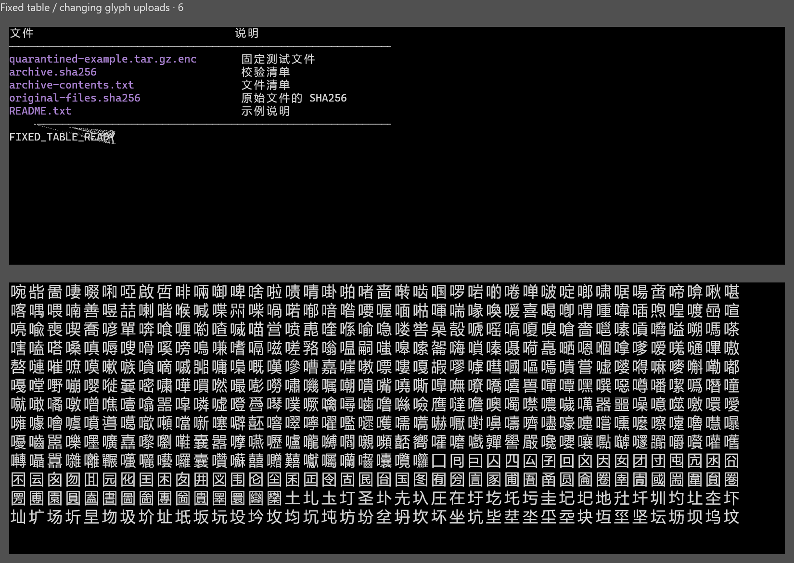
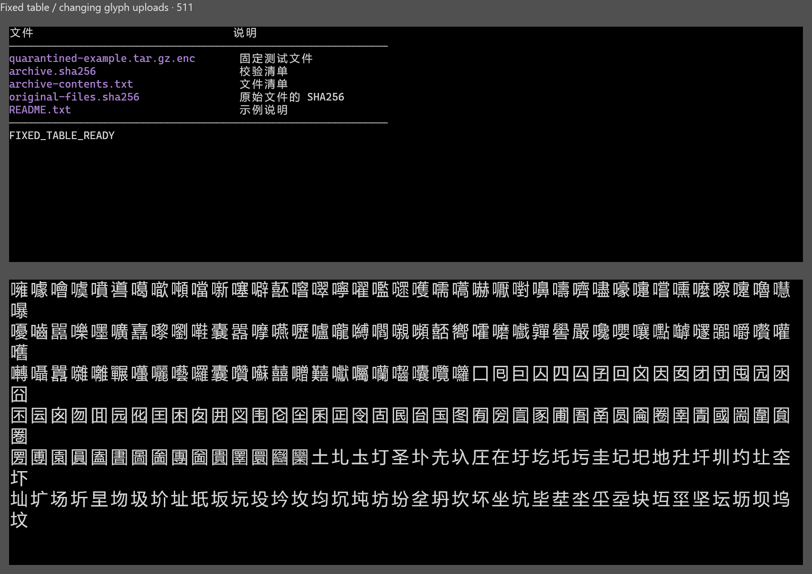

# 0.4.9 rendering checks

[简体中文](rendering-0.4.9.md) | English

The user reported occasional overlapping or stretched text that recovered after scrolling. A fixed local table and a changing glyph region in another terminal reproduced one corrupt frame on the old per-mesh upload path: 1214 fixed-region pixels changed in one of 48 captures. Uploading the whole frame's geometry before drawing preserved all 48 corresponding frames, with an identical first-frame PNG digest.

The native captures below are unedited. The upper table is the comparison region; the lower region is synthetic glyph stress. No real user directories, conversations or model requests are included. The early comparison used a diagnostic prototype; the final pixel probe uses one window, with multi-window hints tested separately. Provenance and SHA-256 are in [SOURCE.json](images/rendering-0.4.9/SOURCE.json).

Transient corruption on the old path:

The 512th capture after the fix:

## Validation and acceptance

- Pass 201 Rust and 16 Python regressions, governance, formatting and Clippy.
- Capture 656 frames at 100%/103%/110%/200% with identical fixed-region pixels and visible-grid hashes. The 512-capture 103% run took about 45 seconds without sustained process-private-memory growth; this does not establish hour-scale load stability.
- Inspect five typography scales, three native-hint scales and smoke with six real PowerShell PTYs. Scheduling timeouts in the combined multi-window pixel prototype remain separate failures, never pixel passes.
- The user tested preview.5, reported no issues and authorized stable 0.4.9 publication. Developer checks made no paid model requests. Long-term real-Agent acceptance and controlled graphics fixtures are recorded separately.

See the [script index](../scripts/README.en.md) for reproduction commands and parameters, and the [changelog](../CHANGELOG.en.md) for shipped changes.
