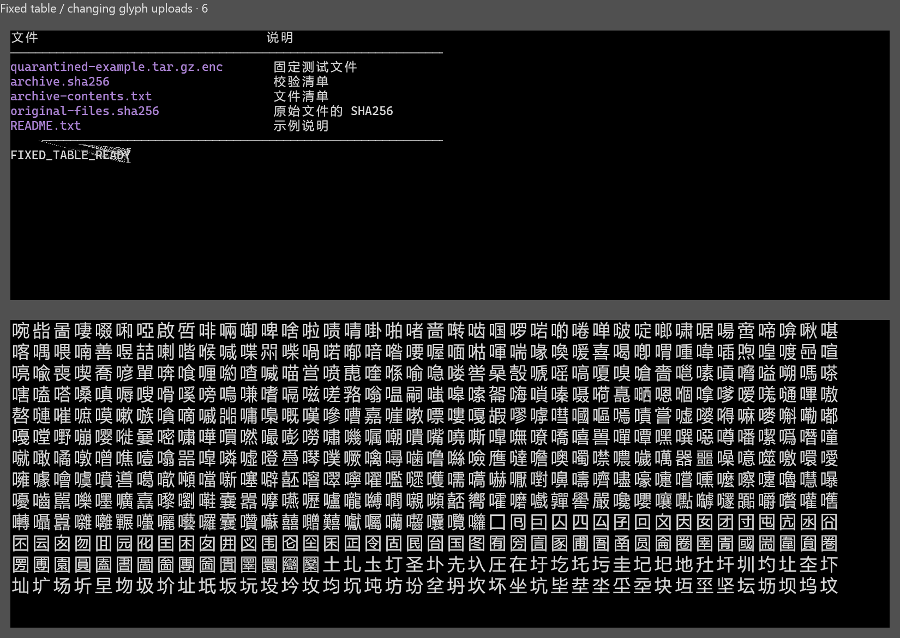
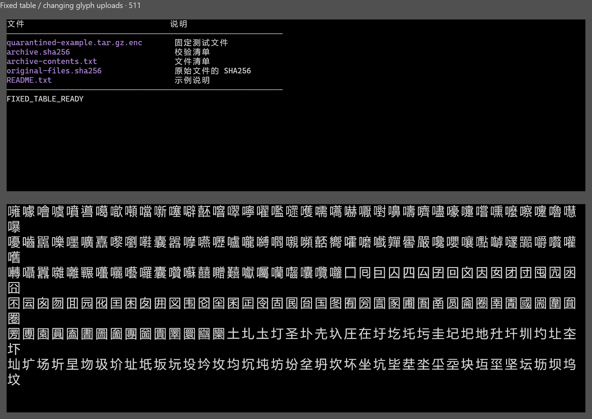

# 0.4.9 渲染核查

简体中文 | [English](rendering-0.4.9.en.md)

用户报告文字偶发重叠、拉扯，滚动后恢复。固定本地表格与另一终端区域的变化字形，在旧的逐网格上传路径中捕获一帧错绘：48 帧中的一帧有 1214 个固定区域像素改变。新路径先上传整帧几何，再按原顺序绘制；同一组 48 帧均保持一致，首帧 PNG 摘要也相同。

下方是未编辑的原生截图。上方表格为检查区域，下方为合成字形压力区域；没有真实用户目录、对话或模型请求。早期对照使用诊断原型，最终像素探针采用单窗口，多窗口提示由独立探针核查。图片来源与 SHA-256 见 [SOURCE.json](images/rendering-0.4.9/SOURCE.json)。

旧路径的瞬时错绘：

修复后的第 512 帧：

## 验证与验收

- 201 项 Rust、16 项 Python 回归与治理、格式、Clippy 通过。
- 100%／103%／110%／200% 共采样 656 帧，固定区域像素及可见网格哈希一致；103% 连续采样 512 帧，约 45 秒的场景中未见进程私有内存持续增长。此证据不等同于小时级负载测试。
- 五档字体、三档原生悬停提示及六个真实 PowerShell PTY smoke 通过并检查截图；混合多窗口像素探针的调度超时单列失败，没有计为像素通过。
- 用户实际测试 preview.5 后确认无问题，并授权 0.4.9 正式发行；开发侧没有主动发起付费模型请求。真实 Agent 的长期验收与受控图形样例分别记录。

复现命令与参数见[脚本目录](../scripts/README.md)，正式改动见[更新日志](../CHANGELOG.md)。
